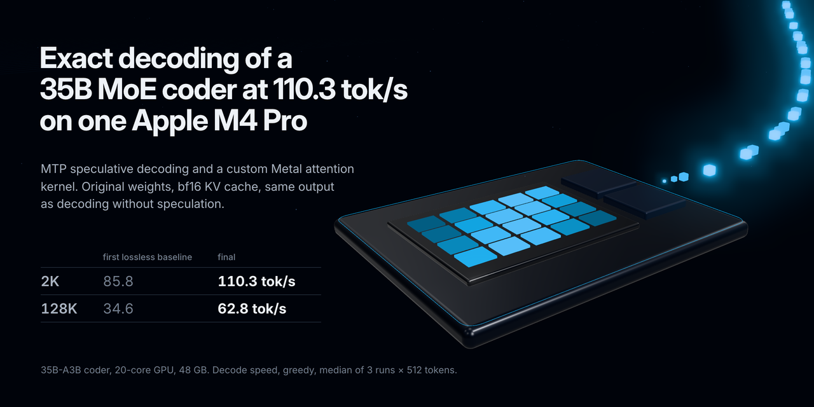
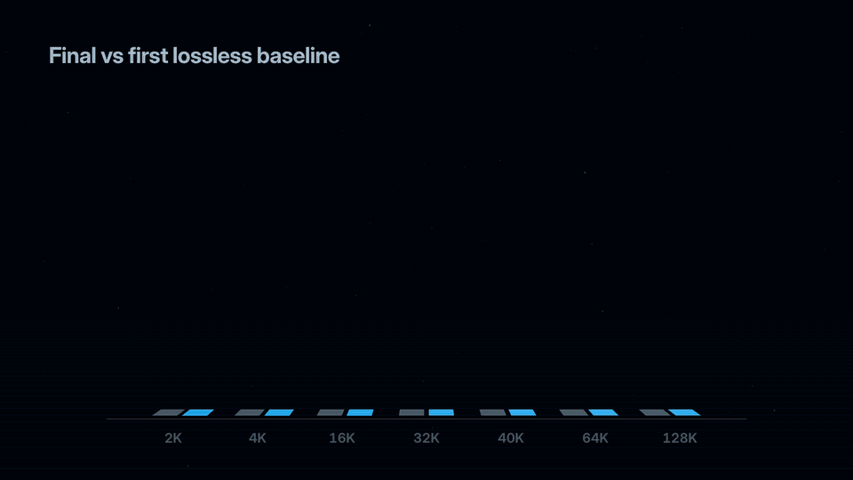
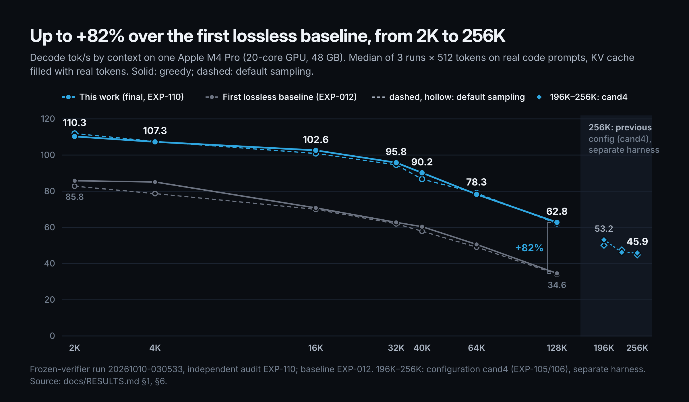
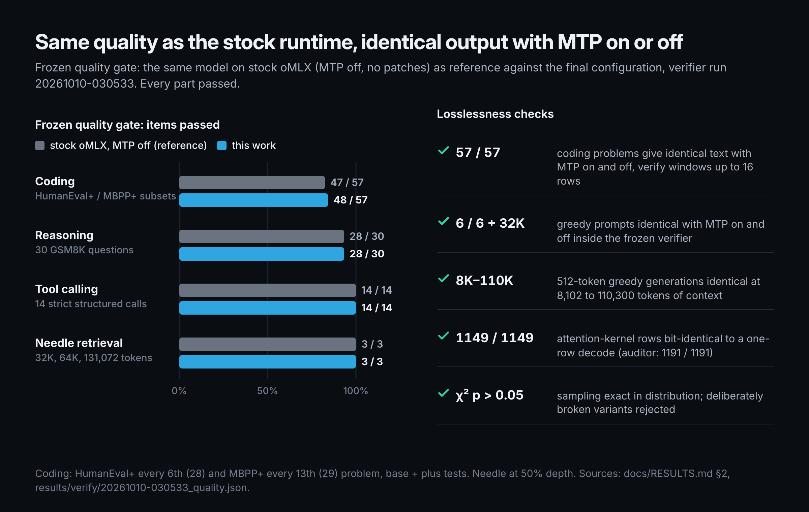
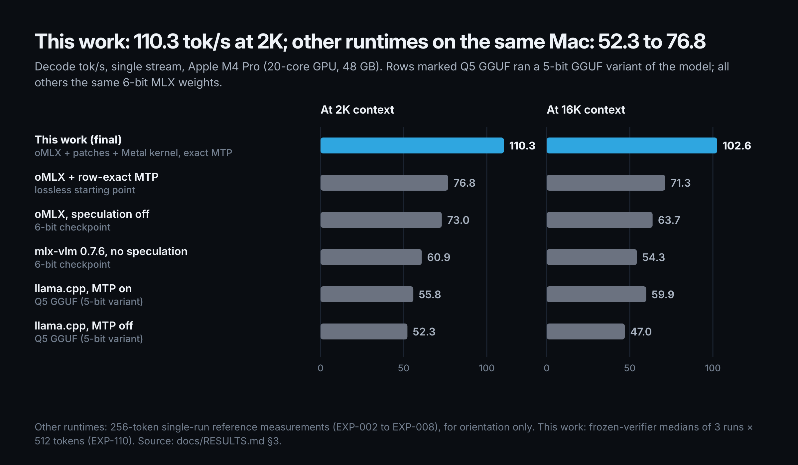
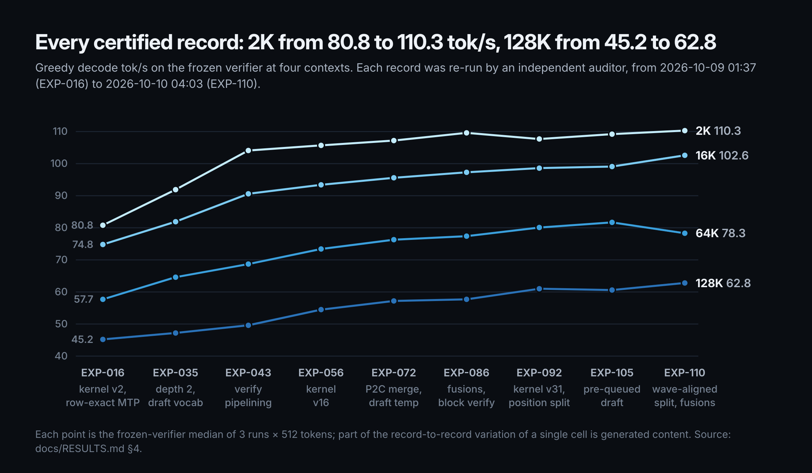
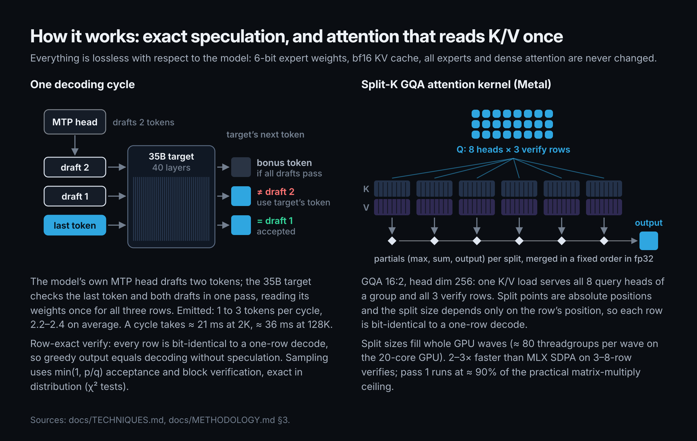
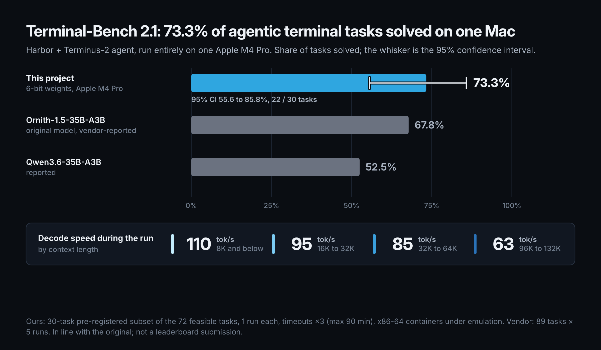

# PureDrive-35B-A3B-MLX — a 35B-A3B MoE coder at 110 tok/s on a single Apple M4 Pro, lossless



**PureDrive is a patched [oMLX](https://github.com/jundot/omlx) / MLX runtime that runs a 35B-A3B mixture-of-experts coding model (Qwen3.5/3.6-35B-A3B architecture, 6-bit experts, native multi-token-prediction head) on one 48 GB Apple M4 Pro at 110.3 tok/s at 2K context and 62.8 tok/s at 128K, +26...+82% over the first lossless baseline, with exact speculative decoding: original weight precision, a bf16 KV cache, full attention, all 8 routed experts, and output proven identical to non-speculative decoding. It serves a local OpenAI-compatible API and scored 73.3% on a Terminal-Bench 2.1 subset.**

> **Install it with your AI coding agent:** tell it *"Read AGENTS.md in https://github.com/SerOv66/PureDrive-35B-A3B-MLX and install it on my Mac."* [`AGENTS.md`](AGENTS.md) has every command, the expected output of each step and troubleshooting. Manual install: [Quick start](#quick-start).

## TL;DR

* **The model.** [Cyber-Tiel-Coder-35B-A3B-MLX-oQ6e-MTP](https://huggingface.co/peculiar-ragdoll/Cyber-Tiel-Coder-35B-A3B-MLX-oQ6e-MTP) (MIT), an abliterated, oQ6e-requantized derivative of [Ornith-1.5-35B-A3B](https://huggingface.co/ornith-ai/Ornith-1.5-35B-A3B) (via [huihui-ai](https://huggingface.co/huihui-ai/Huihui-Ornith-1.5-35B-A3B-abliterated)), a Qwen3.5-MoE-architecture 35B-A3B coder (40 layers: 30 Gated-DeltaNet + 10 full-attention; 256 experts, top-8, plus a shared expert; 6-bit experts, 8-bit attention/embedding/`lm_head`), running in MLX with a native multi-token-prediction (MTP) head. Weights are not redistributed here; download them from the Hugging Face repo above (see *Model credits / licenses*).
* **What we did.** Exact speculative decoding with the checkpoint's own MTP head and a **row-exact verify pass**; a **custom Metal split-K GQA attention kernel** that reads K/V once for all verify rows and heads; and a series of scheduling and fusion improvements, each proven bit-identical or exact in distribution. Eight independently audited records took decode from 80.8 to 110.3 tok/s at 2K and from 45.2 to 62.8 tok/s at 128K.
* **Agentic benchmark.** [Terminal-Bench 2.1](docs/TERMINAL_BENCH.md) (Harbor + Terminus-2), run entirely on the Mac: **73.3%** (22 of 30 pre-registered tasks, 95% CI 55.6–85.8), in line with the original model's vendor-reported 67.8%; decode stayed at 110 tok/s below 8K and 63 tok/s at 96–132K context during the run.
* **How it was measured.** A frozen benchmark harness: 7 exact context lengths, real code prompts, KV cache filled with real tokens, ≥ 3 runs × ≥ 512 generated tokens per cell, greedy *and* default sampling, medians reported, an independent auditor for every record.

[](assets/trailer.mp4)

### Speed (decode tok/s, median of 3 runs × 512 tokens, greedy / default sampling)

| Context | 2K | 4K | 16K | 32K | 40K | 64K | 128K | 256K* |
|---|---|---|---|---|---|---|---|---|
| **This work** | **110.3 / 111.9** | **107.3 / 107.5** | **102.6 / 100.9** | **95.8 / 94.6** | **90.2 / 86.7** | **78.3 / 79.0** | **62.8 / 62.2** | 45.9 / 44.8 |
| First lossless baseline (EXP-012) | 85.8 / 82.8 | 85.1 / 78.7 | 70.8 / 70.0 | 62.8 / 62.0 | 60.4 / 57.9 | 50.6 / 49.1 | 34.6 / 34.2 | - |
| Speed-up (greedy / default) | +29% / +35% | +26% / +37% | +45% / +44% | +53% / +53% | +49% / +50% | +55% / +61% | +82% / +82% | - |

Frozen-verifier run `20261010-030533` (independent audit "EXP-110"); M4 Pro 20-core GPU / 48 GB; default sampling = T 0.6, top-p 0.95, top-k 20. Also: 128K × 2,048-token generation 63.2 tok/s; after 10 minutes of continuous generation 2K = 110.8 / 112.2 tok/s; thermal pressure Nominal; swap +0 MB.
\* 256K (262,144 tokens): measured with the **previous certified configuration `cand4`** (EXP-105/106) in a **separate harness, outside the frozen verifier**; KV cache bf16, completely filled with real tokens (196K: 53.2 / 50.1).



### Quality (the output is the model's output)

| Check | Result |
|---|---|
| Greedy output with speculation vs without | **identical**: 57/57 coding problems (verify windows up to 16 rows), 6/6 fixed prompts + one 32K prompt, long generations at 8K / 16K / 49K / 110K context |
| Sampling | emitted-token distribution exact (chi-square tests on the draft temperature, block verification, compiled sampler, pre-queued draft) |
| Coding: HumanEval+ (28) + MBPP+ (29), base+plus tests | **48 / 57** (stock runtime without speculation: 47 / 57) |
| Reasoning: 30 GSM8K problems | **28 / 30** (stock: 28 / 30) |
| Tool calling: 14 strict structured-call cases | **14 / 14** (stock: 14 / 14) |
| Needle retrieval at 32K / 64K / 131K (50% depth) | **3 / 3** (stock: 3 / 3) |
| Long context at 262K (`cand4`): needle, multi-key, multi-value retrieval | 3/3, 3/3, 3/3 (variable tracking is 0/3 at both 131K and 262K, a property of the model on that task) |
| Attention accuracy vs an fp32 reference (KL, teacher-forced) | 0.004-0.054 nats depending on context, in the same band as the stock kernel (0.006-0.032); top-1 agreement 95.7-98.7% |



How each check was run, the thresholds and the raw files: [`docs/METHODOLOGY.md`](docs/METHODOLOGY.md), [`docs/RESULTS.md`](docs/RESULTS.md).

### Other runtimes on the same weights and machine (reference points)

| Setup | 2K | 16K |
|---|---|---|
| mlx-vlm 0.7.6, 6-bit checkpoint, no speculation | 60.9 | 54.3 |
| oMLX main, 6-bit checkpoint, speculation off | 72.95 | 63.74 |
| llama.cpp, 5-bit GGUF variant, MTP off / on | 52.27 / 55.83 | 47.03 / 59.89 |
| **This work (greedy / default medians)** | **110.3 / 111.9** | **102.6 / 100.9** |

The other rows are 256-token single-run measurements, shown for orientation only; the last row is a matrix median.



### Progression of certified records (greedy tok/s, frozen verifier, independent audit)

| Record | What was added | 2K | 16K | 64K | 128K |
|---|---|---|---|---|---|
| EXP-016 | custom attention kernel v2 + row-exact MTP | 80.8 | 74.8 | 57.7 | 45.2 |
| EXP-035 | depth 2, 32K draft vocabulary, shared rows, losslessness fix | 91.9 | 81.9 | 64.6 | 47.2 |
| EXP-043 | verify pipelining | 104.1 | 90.6 | 68.7 | 49.6 |
| EXP-056 | attention kernel v16 | 105.7 | 93.4 | 73.4 | 54.5 |
| EXP-072 | pass-2 merge P2C, narrow tiles, draft temperature | 107.2 | 95.6 | 76.3 | 57.2 |
| EXP-086 | fused add+RMSNorm, block verification, GDN kernels | 109.6 | 97.3 | 77.4 | 57.7 |
| EXP-092 | attention v31 + position-based split | 107.7 | 98.6 | 80.1 | 61.0 |
| EXP-105 | pre-queued draft, compiled sampler, fast commit | 109.2 | 99.1 | 81.7 | 60.6 |
| **EXP-110** | wave-aligned split, fused q/k prep, fused output | **110.3** | **102.6** | 78.3 | 62.8 |



Full per-cell tables (both sampling modes, constancy, stability, quality, KL, tokens per cycle): [`docs/RESULTS.md`](docs/RESULTS.md).

## Key techniques

All are lossless with respect to the target model; each has an environment flag, a measured gain and an exactness argument in [`docs/TECHNIQUES.md`](docs/TECHNIQUES.md).



| Technique | Effect |
|---|---|
| **Row-exact MTP verification** (every verify row bit-identical to a one-row decode) | turns a speculation that diverged at token 4-5 into one whose greedy output is identical to non-speculative decoding |
| **Custom Metal GQA attention** (K/V read once for 8 heads × 3 rows; split-K with position-based splits; v2 → v16 → v31 → wave-aligned) | 2-3× faster than MLX SDPA on 3-8 row verifies; +82% at 128K overall with the rest of the stack |
| **Verify pipelining** (`async_eval` every 2 layers) | GPU busy 85% → 97%; +5...+13% |
| **Exact sampling-mode speculation**: Leviathan/Chen acceptance, draft temperature 0.3, **block verification** (Sun et al.) | +1.2% and +1.3% accepted tokens/cycle, proven exact by χ² tests |
| **Pre-queued draft, compiled draft sampler, fast cache commit** | +2.6...+4.0% (hides ≈ 0.5-0.9 ms of host time per cycle) |
| **Bit-identical fusions and tile retunes** (add+RMSNorm, q/k norm + RoPE, GDN recurrence, projection tiles) | +0.7...+1.3% each |
| Draft-side only: 32K-token draft vocabulary, 4096-token attention window on the MTP head | ≈ +3% (vocabulary); the target always verifies with the full `lm_head` and full attention |

## Engineering notes

What worked and why, with practical tips: row-exact verification, wave-aligned splits, bit-identity testing of every kernel parameter (even grid-only ones), clearing MLX's buffer pool after prefill (6-7% at 128K), A/B protocol, where the time goes. See [`docs/ENGINEERING_NOTES.md`](docs/ENGINEERING_NOTES.md).

## Agentic coding harness (Phase 4)

Pi 0.73.1 is the recommended command-line coding agent on top of the certified server (`configs/q6_omlx_cand5.json`, prefix cache on). It was evaluated together with Hermes Agent v0.20.4 on 4 short tasks (bug fix, feature with tests, multi-file refactor, debugging from terminal errors) x 3 repetitions, plus a long session (>= 64K context). Medians per cell, sampling T 0.6 / top_p 0.95 / top_k 20 set server-side for both:

| Task | Harness | Success | Wall (s) | Requests | Prompt / completion tokens | Cache hit | Decode tok/s* | TTFT (s) |
|---|---|---|---|---|---|---|---|---|
| t1 bugfix | **Pi** | 3/3 | **15.4** | 5 | 18.3K / 1.0K | 83% | 110.5 | 1.02 |
| | Hermes Agent | 3/3 | 40.7 | 6 | 46.5K / 3.3K | 89% | 120.1 | 1.39 |
| t2 feature | **Pi** | 3/3 | **25.8** | 6 | 26.3K / 1.9K | 78% | 104.4 | 1.04 |
| | Hermes Agent | 3/3 | 45.9 | 10 | 86.4K / 3.5K | 92% | 108.8 | 0.81 |
| t3 refactor | **Pi** | 3/3 | **22.6** | 15 | 50.2K / 1.6K | 91% | 112.0 | 0.44 |
| | Hermes Agent | 3/3 | 39.9 | 7 | 57.9K / 2.8K | 85% | 117.3 | 2.11 |
| t4 debug | **Pi** | 3/3 | **15.5** | 6 | 24.4K / 0.9K | 77% | 116.1 | 0.83 |
| | Hermes Agent | 3/3 | 47.7 | 21 | 232K / 3.2K | 95% | 126.2 | 1.24 |

\* Decode tok/s are server-reported counters (completion tokens / generation time) over short agentic completions at 2K-30K context: **indicative only, not comparable to the frozen-verifier matrix** in the speed table above.

* **Pi completed 12/12 short-task runs** (24/24 across both harnesses) without a tool-call parsing error. Its median wall time is **1.8-3.1x lower** (13.7-68.5 s over all runs): a system prompt of about 2K tokens (4 tools) versus about 5.6K, and fewer turns. Prefix-cache hit 77-95%.
* **Long session** (nine CPython standard-library modules: fix a planted bug and document every public name by reading each file in full) **completed with Pi in both runs**, with the prefix cache serving 91-96% of prompt tokens:

| Pi, long session | Declared window | Wall | Requests | Max context | Cache hit |
|---|---|---|---|---|---|
| run 1 | 262,144 | 302 s | 48 | 65.5K | 96% |
| run 2 | 98,304 | 469 s | 31 | 103.9K | 91% |

* **Launch:** `./serve.sh` (everyday use) or `harness/server_up.sh logs/harness_server.log` (time-budgeted, as in the measurements), then `PORT=8000 harness/pi.sh /path/to/project`. Tasks, scripts, configs and per-run summaries are in [`harness/`](harness/README.md).

## Terminal-Bench 2.1

The certified server was evaluated on Terminal-Bench 2.1 with the vendor's harness (Harbor 0.24.0, Terminus-2 agent, JSON parser, T 1.0 / top_p 1.0), the task containers running in a local VM on the same Mac:

| Model | Setup | Terminal-Bench 2.1 (Terminus-2) |
|---|---|---|
| **This work** (6-bit, one M4 Pro) | 30-task pre-registered subset, 1 run per task | **73.3%** (22/30, 95% CI 55.6–85.8) |
| Ornith-1.5-35B-A3B (original, vendor-reported) | 89 tasks, mean of 5 runs | 67.8% |
| Qwen3.6-35B-A3B (reported on the Ornith-1.5 card) | 89 tasks | 52.5% |



* **In line with the original model**: 67.8 lies inside our confidence interval. Subset evaluation, not a leaderboard submission: 30 tasks drawn with a fixed seed from the 72 this machine can run, one run each, agent time limits × 3 (max 90 min) against the vendor's 4 h, containers under x86-64 emulation. All differences, the protocol and a per-task table are in [`docs/TERMINAL_BENCH.md`](docs/TERMINAL_BENCH.md).
* **Speed during the run** (884 requests, 2.6 M generated tokens): median decode 109.6 tok/s at 0–8K context, 94.7 at 16–32K, 85.0 at 32–64K, 62.9 at 96–132K, consistent with the frozen-verifier matrix.

## How the numbers were made trustworthy

A frozen benchmark harness (`bench/verify_target.py`, sha256-pinned) produced every certified number; every record was re-run by an independent auditor agent with a clean context; losslessness is tested by 57-problem and long-generation bit-identity tests (MTP on vs off), kernel bit tests with mutation checks, and χ² tests for sampling;
forbidden shortcuts (top-k reduction, pruning, windowed/sparse target attention, KV eviction, relaxed acceptance, padded/synthetic prompts, best-of-N...) are checked point by point. The work was driven by autonomous AI coding agents (an author agent, executor agents, independent auditors) under a written specification.
Full description: [`docs/METHODOLOGY.md`](docs/METHODOLOGY.md).

## Quick start

> Model weights are **not** included: the checkpoint [peculiar-ragdoll/Cyber-Tiel-Coder-35B-A3B-MLX-oQ6e-MTP](https://huggingface.co/peculiar-ragdoll/Cyber-Tiel-Coder-35B-A3B-MLX-oQ6e-MTP) (MIT, about 28 GB) is downloaded from Hugging Face. Step-by-step guide with checks: [`AGENTS.md`](AGENTS.md).

```bash
git clone https://github.com/SerOv66/PureDrive-35B-A3B-MLX PureDrive-35B-A3B-MLX && cd PureDrive-35B-A3B-MLX
scripts/setup_omlx.sh        # oMLX @ cc1fdc9 + certified patch + Metal kernel + venv (a few minutes)
uvx --from huggingface_hub hf download peculiar-ragdoll/Cyber-Tiel-Coder-35B-A3B-MLX-oQ6e-MTP --local-dir models/Cyber-Tiel-Coder-35B-A3B-MLX-oQ6e-MTP
mkdir -p models/omlx-models && ln -sfn "$PWD/models/Cyber-Tiel-Coder-35B-A3B-MLX-oQ6e-MTP" models/omlx-models/coder-q6
./serve.sh                   # OpenAI-compatible API: http://127.0.0.1:8000/v1, model "coder-q6"
```

Requirements: an Apple-silicon Mac (measured on an M4 Pro, 20-core GPU, 48 GB, macOS 27.0.1), `git`, [`uv`](https://github.com/astral-sh/uv). To reproduce the published measurements with the frozen benchmark harness (about 20 minutes), follow [`docs/REPRODUCE.md`](docs/REPRODUCE.md).

## FAQ

**How fast does a 35B mixture-of-experts model run on an Apple M4 Pro?**
With PureDrive, single-stream decode of the 6-bit 35B-A3B coder on an M4 Pro (20-core GPU, 48 GB) runs at 110.3 tok/s at 2K context, 102.6 at 16K, 95.8 at 32K, 78.3 at 64K and 62.8 at 128K (greedy medians of 3 × 512 tokens, frozen benchmark harness), and 45.9 tok/s at 256K (previous certified configuration). During a real agentic workload (Terminal-Bench, 884 requests) decode stayed at 110 tok/s below 8K context and 63 tok/s at 96–132K.

**Does the speed-up change the model's output?**
No. Greedy output is byte-identical to non-speculative decoding (57/57 coding problems, long generations up to 110K context), and sampling is exact in distribution (speculative-sampling acceptance plus block verification, checked with χ² tests). Weights keep their original precision, the KV cache is bf16, attention is full over all keys, and all 8 routed experts run.

**Which model does it run?**
[Cyber-Tiel-Coder-35B-A3B-MLX-oQ6e-MTP](https://huggingface.co/peculiar-ragdoll/Cyber-Tiel-Coder-35B-A3B-MLX-oQ6e-MTP), a 6-bit MLX ("oQ6e") checkpoint with a native multi-token-prediction head, derived from Ornith-1.5-35B-A3B. Architecture: Qwen3.5/3.6-35B-A3B (`qwen3_5_moe`: 40 layers = 30 Gated DeltaNet + 10 full attention, 256 experts top-8 plus a shared expert, about 3B active parameters per token).

**Does it work with Qwen3.6-35B-A3B or other checkpoints?**
The runtime targets the `qwen3_5_moe` architecture with this quantization layout and an MTP head stored under `language_model.mtp.*`. All published numbers are for the checkpoint above; other fine-tunes are untested here, and their speed depends on how often their MTP drafts are accepted.

**What Mac do I need?**
Apple silicon. The numbers were measured on an M4 Pro (14-core CPU, 20-core GPU, 48 GB, macOS 27.0.1); the weights take about 28 GB, and 48 GB covers contexts up to 128K as is and 256K with a raised GPU wired-memory limit. Other chips run it at different speeds (kernel split sizes are tuned to 20 GPU cores); machines with less than 48 GB are untested.

**How do I connect my coding agent?**
`./serve.sh` exposes an OpenAI-compatible API at `http://127.0.0.1:8000/v1` (model `coder-q6`, any API key, tool calling, 262,144-token context window). Tested with Pi (12/12 coding tasks), Hermes Agent and Terminus-2. See [AGENTS.md](AGENTS.md).

**How does it compare with llama.cpp, mlx-vlm and stock oMLX?**
On the same Mac and weights: mlx-vlm 60.9 tok/s at 2K, stock oMLX 72.95, llama.cpp with a 5-bit GGUF and MTP 55.83; PureDrive 110.3 (the other runtimes are single 256-token runs, shown for orientation).

**How good is it at agentic coding?**
73.3% on Terminal-Bench 2.1 (22 of 30 pre-registered tasks, 95% CI 55.6–85.8, Terminus-2 agent), with the model and every task container running on the Mac; the original model's vendor-reported score is 67.8%.

**What makes it fast?**
Exact speculative decoding with the model's own MTP head and a row-exact verify pass; a custom Metal split-K GQA attention kernel that reads the KV cache once for all heads and verify rows; verify pipelining, a pre-queued draft and bit-identical kernel fusions.

**Can an AI agent install it for me?**
Yes. Tell your coding agent to read [AGENTS.md](AGENTS.md) and install the project: it contains the commands, the expected output of every step and troubleshooting.

## Repository map

| Path | Content |
|---|---|
| `AGENTS.md` | install and run instructions for AI coding agents (and humans) |
| `serve.sh` | starts the server with the certified configuration (OpenAI-compatible API) |
| `patches/` | the certified patch against oMLX `cc1fdc9` (`omlx_c35_EXP110.patch`) |
| `kernels/` | the Metal GQA attention kernel module and micro-benchmarks |
| `configs/` | server launcher, JSON configurations of every certified step, 32K draft vocabulary |
| `bench/` | frozen benchmark harness, client and prompts, 256K harness, kernel/identity tests (`tests/`), audit tools (`audit/`) |
| `harness/` | Phase 4: agentic-harness evaluation (Pi, Hermes Agent): task sandboxes, launch/measure scripts, configs, per-run summaries (see `harness/README.md`) |
| `quality/` | quality gate (coding, reasoning, tools, long context), thresholds, KL tool, results |
| `results/` | `RESULTS.csv` (measurements), verifier outputs of every certified run, original file hashes |
| `results/terminal-bench/` | Terminal-Bench 2.1 per-task results, analysis script, seeded task order and selection |
| `docs/` | `METHODOLOGY`, `TECHNIQUES`, `RESULTS`, `ENGINEERING_NOTES`, `REPRODUCE`, `TERMINAL_BENCH` |

## References

* Y. Leviathan, M. Kalman, Y. Matias. *Fast Inference from Transformers via Speculative Decoding.* ICML 2023. arXiv:2211.17192 — acceptance rule used for sampling-mode speculation.
* C. Chen, S. Borgeaud, G. Irving, J.-B. Lespiau, L. Sifre, J. Jumper. *Accelerating Large Language Model Decoding with Speculative Sampling.* 2023. arXiv:2302.01318.
* Z. Sun, U. Mendlovic, Y. Leviathan, A. Aharoni, J. H. Ro, A. Beirami, A. T. Suresh. *Block Verification Accelerates Speculative Decoding.* ICLR 2025. arXiv:2403.10444 — Algorithm 2 used for sampling-mode verification.
* F. Gloeckle et al. *Better & Faster Large Language Models via Multi-token Prediction.* 2024. arXiv:2404.19737; DeepSeek-AI, *DeepSeek-V3 Technical Report*, arXiv:2412.19437 — multi-token-prediction heads as drafters.
* T. Dao, D. Haziza, F. Massa, G. Sizov. *Flash-Decoding for long-context inference* (2023) and T. Dao, *FlashAttention-2*, arXiv:2307.08691 — split-K decode attention; K. Hong et al., *FlashDecoding++*, arXiv:2311.01282 — fixed-reference softmax variants.
* S. Yang, J. Kautz, A. Hatamizadeh. *Gated Delta Networks: Improving Mamba2 with Delta Rule.* ICLR 2025. arXiv:2412.06464 — the linear-attention layers of the model family.
* oMLX (github.com/jundot/omlx, Apache-2.0) — the runtime patched here, including its "Lightning MTP"; MLX and mlx-lm / mlx-vlm (Apple and contributors).
* J. Liu et al. *Is Your Code Generated by ChatGPT Really Correct?* (EvalPlus), NeurIPS 2023, arXiv:2305.01210; M. Chen et al., *Evaluating LLMs Trained on Code* (HumanEval), arXiv:2107.03374; J. Austin et al., *Program Synthesis with Large Language Models* (MBPP), arXiv:2108.07732; K. Cobbe et al., *Training Verifiers to Solve Math Word Problems* (GSM8K), arXiv:2110.14168.

## Model credits / licenses

The measurements use **[peculiar-ragdoll/Cyber-Tiel-Coder-35B-A3B-MLX-oQ6e-MTP](https://huggingface.co/peculiar-ragdoll/Cyber-Tiel-Coder-35B-A3B-MLX-oQ6e-MTP)** (MIT), downloaded from Hugging Face; its weight files are byte-identical (sha256) to the checkpoint measured here. Lineage: [Ornith-1.5-35B-A3B](https://huggingface.co/ornith-ai/Ornith-1.5-35B-A3B) (ornith-ai, MIT) → [Huihui-Ornith-1.5-35B-A3B-abliterated](https://huggingface.co/huihui-ai/Huihui-Ornith-1.5-35B-A3B-abliterated) (huihui-ai, MIT; refusal-direction removal) → [Cyber-Tiel-Coder-35B-A3B-MLX-oQ6e-MTP](https://huggingface.co/peculiar-ragdoll/Cyber-Tiel-Coder-35B-A3B-MLX-oQ6e-MTP) (peculiar-ragdoll, MIT; Ornith's bf16 MTP head grafted back, oMLX oQ6e requantization). The architecture is the Qwen3.5/3.6-35B-A3B family ([Qwen](https://huggingface.co/Qwen/Qwen3.6-35B-A3B), Apache-2.0).

| Component | Author | License |
|---|---|---|
| Ornith-1.5-35B-A3B (base model) | ornith-ai | MIT |
| Huihui-Ornith-1.5-35B-A3B-abliterated | huihui-ai | MIT |
| Cyber-Tiel-Coder-35B-A3B-MLX-oQ6e-MTP (the checkpoint used) | peculiar-ragdoll | MIT |
| Qwen3.5/3.6-35B-A3B (architecture family) | Qwen | Apache-2.0 |
| oMLX (inference runtime the patches apply to) | oMLX contributors ([source](https://github.com/jundot/omlx)) | Apache-2.0 |
| Terminal-Bench 2.1, Harbor, Terminus-2 (agentic benchmark and harness) | harbor-framework ([source](https://github.com/harbor-framework/harbor)) | Apache-2.0 |
| "Sharp" chat template v22.5.0 (embedded in the checkpoint, used as shipped) | froggeric | as distributed with the checkpoint |
| This repository (patches, kernels, benchmark code, docs) | see `LICENSE` | Apache-2.0 |

All results in this repository are for this derivative served by the runtime described here; scores published by the model vendors for other models are not ours and are not claimed.

## License

Apache License 2.0 (see `LICENSE`), the same license as oMLX, whose commit `cc1fdc9` the patches apply to. The patches are modifications of oMLX source; oMLX is © oMLX contributors. The benchmark corpus is CPython 3.12 standard-library source (Python Software Foundation License); it is not redistributed here, `bench/corpus/build_corpus.py` rebuilds it byte-exactly (sha256-checked). Datasets used by the quality suite are downloaded from their original sources and keep their own licenses. No model weights are distributed; the checkpoint used, its base models and their licenses (MIT) are listed under *Model credits / licenses*.
